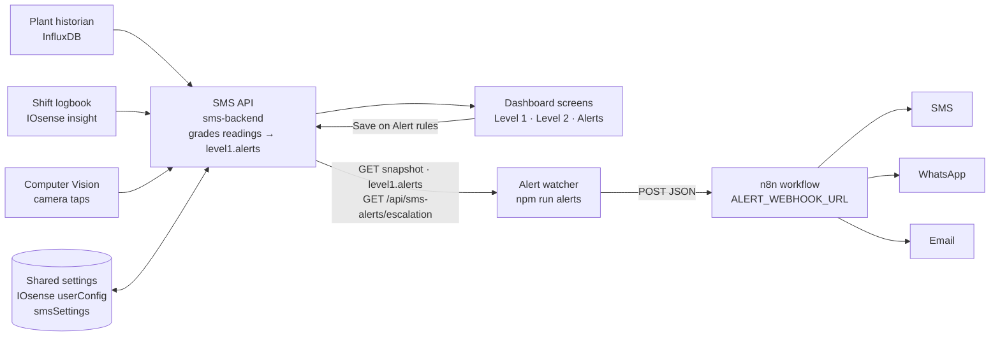

# SMS Alerts — how the whole system works

MSP Steel Melt Shop (SMS) dashboard · state as of 21 Nov 2026, deployed commit `960ead2`

This covers every part of the alerting: what can raise an alert, how a rule is graded, how the plant tunes it on screen, who gets told and when, what the webhook receives, and how it runs in production.

---

## 1. The short version

- **One evaluator.** The dashboard API grades every reading against its band and builds the list of open alarms. The screens show that list, and the alert watcher reads the same list. A message and the row on screen can never disagree.
- **A separate watcher process** polls that list every 60 s. It decides what is news (one KPI, one heat), stamps on the escalation level and its recipients, and POSTs JSON to a webhook.
- **The webhook receiver (an n8n workflow)** does the actual SMS / WhatsApp / email sending. The watcher sends nothing to phones itself.
- **All tuning is done in the UI** (Alert rules screen). Settings live in one shared IOsense record, so every deployment and the watcher pick up a save within about 2 minutes.



---

## 2. What can raise an alert

Every rule is a **rule id** (`<family>:<asset>`). The full list is built from the fleet and tag map (`sms-backend/src/alerts/catalogue.ts`), so a rule shows on the settings screen before it has ever fired. That's about 55 rules today.

| Family | Rule id | Asset | Source | Graded per | Fires as |
|---|---|---|---|---|---|
| Heat cycle time | `cycle:SFC 4` | furnace | shift logbook (`sms/furnace-logsheet`) | heat | Heat Cycle Time High / Short |
| Power per MT | `power:SFC 4` | furnace | historian energy ÷ logsheet tonnage | heat | Power / MT High / Low |
| Tap-to-tap time | `t2t:SFC 4 A` | crucible | shift logbook | heat | Tap-to-Tap Time High / Short |
| Tapping temperature | `taptemp:SFC4/1` | pyrometer channel | historian `PYRO*` | pyrometer dip | Tapping Temperature High / Low |
| Logsheet entry issue | `logsheet:SFC 4 A` | crucible | shift logbook | once per bad entry | Logsheet Entry Issue (always **info**) |
| Active downtime | `downtime:SMS` | whole shop | `sms/breakdown` | whole window | Active Downtime High |
| Power-on time | `powerOn:SMS` | whole shop | historian | whole window | Power-On Time Low |

Notes:
- A furnace with no pyrometer tag (SFC 3, SFC 8 today) still gets a `taptemp:SFC 3` rule, marked **cannot fire** with the reason. The same goes for power/MT on a furnace with no power channel.
- **Logsheet entry issues** are raised when a tap-to-tap interval is refused by the average: a relining, a mistyped lining number, a heat never entered or entered twice. Nothing on the floor is out of limits, so the severity is `info`. It is still sent, so the workflow can route it separately.
- The rules themselves are built in `sms-backend/src/kpi/events.ts` (`buildAlerts`). **To add a rule, change `events.ts` and `alerts/catalogue.ts` in the same commit.** Otherwise the settings screen offers a control for a rule that can't fire, or hides one that can.

---

## 3. How a reading becomes an alarm

### 3.1 The band

Every graded measure has **LCL · target · UCL** (`shared/smsLimits.ts`):

- Past the **target** (on the bad side) is **amber → `warning`**.
- Past an **edge** (UCL/LCL) is **red → `critical`**.
- Tapping temperature is two-sided (bad either way); cycle, tap-to-tap and power/MT are bad high and short-flagged low.

Reference bands (provisional, industry figures, replaced as the plant states its own):

| Measure | LCL | Target | UCL |
|---|---|---|---|
| Heat cycle time (min) | 120 | 150 | 180 |
| Tap-to-tap (min) | 140 | 170 | 200 |
| Power / MT (kWh/MT) | 550 | 700 | 800 |
| Tapping temperature (°C) | 1,650 | 1,680 | 1,710 |
| Active downtime | amber > 10 % of window, red > 15 % | | |

The band a rule is actually graded on comes from **one resolver** (`alerts/limits.ts → limitResolver`), used both by the alarm builder and by the Alert rules screen:
1. If a target is stated for that furnace (Settings → Targets), the reference band **moves onto it**, keeping its proportions. Example: a 165-min cycle target gives 132–198.
2. If the plant has stated a band for the furnace (Settings → Operating bands, or the Band column on Alert rules), that goes on top. A furnace with no band of its own falls back to the shop's band, then to the reference.

So the band shown beside a rule is exactly the band it fires on.

### 3.2 Spells, not single readings (`alerts/evaluate.ts`)

The evaluator walks each rule's readings in time order and reports **spells**, each stretch outside the band:

| Cadence | Used by | Raises after | Clears after |
|---|---|---|---|
| `per-heat` | cycle, power/MT, tap-to-tap | 1 bad heat | 2 good heats |
| `per-dip` | tapping temperature | 1 bad dip | 2 good dips |
| `continuous` | (sensor-rate rules; none today) | 2 samples | 3 samples |
| `window` | downtime, power-on | the one figure | — |

- **On-delay**: how many bad readings in a row before a spell opens. Left at the shipped value, it runs at the cadence's own (1 heat, 1 dip).
- **Deadband**: how far back inside the band a reading must come to count as good, so a value sitting on the line doesn't open and close spells. It is either "% of band", meaning a percentage of the target-to-edge distance (cycle: 2 % of 30 min = 0.6 min), or an absolute value in the rule's unit.
- **Severity** is the worst grade the spell reached (amber → warning, red → critical), unless the plant has **pinned** it.
- **Tapping temperature is judged per dip.** The historian holds the last pyrometer reading between dips, so the samples are collapsed into dips: a ≥ 2 °C jump, settled for 5 min, valued where it settled.

### 3.3 The heat an alarm is about

Each alarm row carries `heat: { key, closed, at, value, crucible }`:
- **Cycle, power/MT, tap-to-tap** are only read once their heat is over, so their heat is already closed.
- **A tapping-temperature dip** belongs to the crucible's heat since its last camera-seen tap, and closes at the next tap. The key is named by the *opening* tap, so it never changes as data arrives.
- **Downtime and power-on** have no heat. They are one spell out of limits.
- **The crucible**: for furnace-level rules (cycle, power/MT) it is the logsheet's crucible letter. Failing that, it's the crucible the cameras saw tap within 30 min of heat-off, and failing that, the furnace.

### 3.4 Muting never hides anything

A rule with notifications **off** still produces its row on every screen, marked "off". Muting decides who is told, not whether the condition is real.

---

## 4. Where alerts appear on screen

| Place | What it shows |
|---|---|
| **Level 1 → Drift / Alerts** panel | Open alarms for the selected window and furnace |
| **Level 1 → Heat Timeline → Alerts & Drift Monitor** | Same list, top 5 + "View all" |
| **Level 2 → Active Alerts** | Same list |
| **Sidebar → Alerts** (full screen) | The working view, described below |

All of them read the same `level1.alerts` array from the snapshot. None has a feed of its own.

### 4.1 The Alerts screen (`sms-frontend/src/dashboards/sms/SmsAlerts.tsx`)

- **Open alarms** panel:
  - **Severity strip** (critical / warning / info counts), which doubles as a filter, plus a **Not notifying** count for muted rules.
  - **Open only** switch, **search**, **Asset** filter and **Sort** select.
  - Table columns: **Severity · Asset · Condition · Reading · Band · Standing / Open for · Fired · Notifying**.
  - A `†` on a band means it is a provisional reference figure, not a limit the plant has stated. A **set** tag on severity means it is pinned by configuration.
  - Clicking a row opens the KPI drawer with the formula, inputs and trend behind the alarm.
  - The **Alert rules** button in the header opens the configuration screen.
- **Coverage** panel: what this shop can raise an alert about at all, and which rules **cannot fire** and why (no tag mapped, etc.).

---

## 5. Configuring alerts in the UI — the Alert rules screen

**How to open it:**
- Sidebar → **Alerts** → **Alert rules** button, or
- ⚙ Settings (top right) → **Alerts ↗** tab. That tab hands over to the full screen.

Source: `sms-frontend/src/settings/AlertRules.tsx`, `EscalationMatrix.tsx`, `alertrules.css`.

### 5.1 Layout

```
┌──────────────────────────────────────────────────────────────────────────┐
│ Alert rules — SMS        N rules · N tuned · N off · N cannot fire   ✕ │
│ "Shared. What you save here decides what the alert webhook is sent…"    │  ← header + counts
├──────────────────────────────────────────────────────────────────────────┤
│ [!] Not in step with the shared settings …     (only when sync fails)  │  ← red banner
│ ☑ Limit to one alert per KPI per heat                                    │  ← the big switch
├──────────────────────────────────────────────────────────────────────────┤
│  Shop defaults │ Rules (55) │ Escalation matrix (3 levels)               │  ← tabs
├──────────────────────────────────────────────────────────────────────────┤
│                         (tab content)                                    │
├──────────────────────────────────────────────────────────────────────────┤
│ 2 changes, not saved yet                          [Revert] [Save 2 …]    │  ← footer
└──────────────────────────────────────────────────────────────────────────┘
```

**Nothing is saved until Save.** One Save is **one write**: rule tuning, bands and the escalation matrix go together (`PUT /api/sms-alerts/config`). Invalid input blocks Save and the footer lists what to fix.

### 5.2 The "one alert per KPI per heat" switch

- **On** (shipped): each KPI alerts **once per heat**, to **level 1 only**. If the KPI recovers and goes out again within the same heat, that is not news twice. The next heat that goes out alerts again.
- **Off**: every escalation level is told **on its own interval** while the KPI stays out of limits, and stops when it is back in limits or its heat closes (see §6).

> ⚠ With this switch **on**, levels 2 and above of the escalation matrix are **never used**. The live matrix has 3 levels configured and the switch is on, so today only level 1 receives anything.

### 5.3 Tab: Shop defaults

These apply to every rule in the shop unless a rule says otherwise:

| Setting | Meaning |
|---|---|
| Notifications | On/off for the whole shop |
| On-delay | Bad readings in a row before raising |
| Deadband | Value + mode (% of band / absolute) |
| Severity | "by depth" (amber → warning, red → critical) or pin every alert to one severity. Rarely wanted shop-wide. |

Each row shows its **Source** (shipped / shop) and has a **Back to shipped** link.

### 5.4 Tab: Rules

- **Toolbar:**
  - Search.
  - **Group by**: furnace / crucible / rule type / where it comes from / flat list.
  - Filters: **Tuned** (differs from shipped), **Off**, **Cannot fire**.
- **Groups** start collapsed. Each heading shows its rule count, how many are tuned and how many are off, plus a **bulk notify switch** for everything under it.
- **Columns per rule:**

| Column | What you set |
|---|---|
| Rule | Name + asset; tags **off** / **cannot fire**; hover shows how it is graded |
| **Band** | The furnace's operating band (min – max), the edges it is graded on. The three tap-to-tap rules of a furnace share one band, so editing one moves all three and the row says so. |
| **Notify** | On/off for this rule. Dashed = inherited. |
| **On-delay** | Readings (heats / dips). `n/a` for window figures and logsheet notes. |
| **Deadband** | Value + mode. `n/a` where there is no band. |
| **Severity** | by depth / critical / warning / info |
| Actions | **Undo** (put back what is saved), **Inherit** (clear this rule's own settings so it follows the shop) |

**A blank box inherits.** The grey placeholder in it is the inherited value, from the shop defaults or, for a band, from the shop's band or the reference. A blank is not zero.

**Inheritance order** (narrowest wins), from `shared/smsAlerts.ts → resolveControls`:

```
shipped  →  shop defaults  →  shop setting for this rule  →  furnace defaults  →  this rule's own setting
```

**Validation:**
- On-delay must be a whole number from 1 to 20.
- Deadband can't be negative, and "% of band" can't exceed 50.
- Severity must be one of by depth / critical / warning / info.

A setting saved for a rule that doesn't currently exist (its tag was unmapped) is **kept**, with a warning, and comes back when the tag does.

### 5.5 Tab: Escalation matrix

Who is told, and how often. Up to **10 levels**. Each level has:

- **Every N minutes**: how often this level is told while the alert stands. `0` means once, with the first alert.
- Three channels, each with an **on/off switch** and a **comma-separated contact list**:
  - **SMS**: phone numbers
  - **WhatsApp**: phone numbers
  - **Email**: email ids
- **Remove** button; **+ Add level N** below the last level. With no levels, alerts still go to the webhook with nobody named on them.

**Validation** (`validateEscalation`):
- Phones are normalised (spaces, dashes and brackets stripped; 7–15 digits, leading `+` kept).
- Emails are lower-cased.
- Duplicates are dropped.
- A channel switched **on with nobody on it is refused**. A channel switched off keeps its contacts, so switching it back on doesn't mean retyping.
- Max interval is 10,080 min (a week).

A **"What the webhook receives"** fold-out at the bottom shows the shape of the message for the configured levels.

### 5.6 Related settings (⚙ Settings drawer)

- **Targets**: the plant's stated targets per furnace. A stated target moves the band (§3.1).
- **Operating bands**: the same per-furnace bands as the Band column on Alert rules.
- **Furnace master**: per-crucible capacity and tap-to-tap target.

### 5.7 Where settings are stored, and how fast a save takes effect

- All of it is stored in **one shared document** in the IOsense user-config store (`configType: smsSettings`, `settings/userConfig.ts`), read and written with the account's personal access token in `IOSENSE_BEARER`. Every deployment and the watcher see the same settings.
- **Screens**: the change shows **immediately** (the API clears its snapshot cache on save).
- **Other deployments**: within **2 minutes** (`SETTINGS_REFRESH_MS`).
- **The watcher**: on its next tick after the API it reads has the change. Mutes, pins and bands arrive already applied to the alarm rows, and the matrix is read every tick.
- If the API loses sight of the shared record, Alert rules shows a red **"Not in step with the shared settings"** banner and the watcher's `/health` reports it under `settings.error`.
- `sms-backend/data/sms-settings.json` is a **write-only diagnostic mirror**. It is never read back.

---

## 6. The watcher — deciding what is news (`sms-backend/src/alerts/watch/`)

Run with `npm --prefix sms-backend run alerts` (`tsx src/alerts/watch/main.ts`). It runs **separately from the API**, so restarting the dashboard doesn't stop alerting, and a stuck receiver doesn't take the dashboard down.

### 6.1 Every tick (default 60 s)

1. `GET {SMS_API_URL}/api/sms-snapshot?period=today&view=sms-alerts&sections=level1.alerts` returns the alarm rows for the **plant day** (06:00–06:00 IST). The plant day is used rather than the shift so a heat's readings survive a shift change.
2. `GET {SMS_API_URL}/api/sms-alerts/escalation` returns the matrix. If it can't be read, the last good copy kept in the state file is used.
3. `decide()` (`decide.ts`) works out what is new:
   - Only **active** rows count (still out of limits at the end of the window). Per rule, the worst row standing.
   - **`raised`**: the first message for a KPI on a heat, sent to **level 1**. Id `<ruleId>@<heatKey>`.
   - **`repeated`**: only with one-per-heat **off**:
     - Level 1 is told again every N minutes.
     - Each later level is told first after its own N minutes, then every N.
     - A level with 0 minutes is told once, with the first alert.
     - Repeats stop when the KPI is back in limits or **its heat closes**.
     - Id `<raisedId>~L<level>@<time>`.
   - **Nothing is sent on recovery.** The rule re-arms quietly.
   - **Muted rules** are adopted silently for the heat they're on, so un-muting doesn't fire an old crossing.
   - **Cold start**: everything standing the first time the watcher looks is adopted silently (`primedAt`), so a restart never pages about hours-old conditions.
   - **Severity floor**: `ALERT_WEBHOOK_MIN_SEVERITY` (default `info`, meaning everything). Settings decides by muting, rule by rule.
4. New events go to the **outbox** and are POSTed. Failures retry with backoff (0, 1, 2, 4 … capped at 30 min). New events always go first; retries get what's left of a 20 s budget.

### 6.2 State (`.alert-state/`)

| File | Holds |
|---|---|
| `state.json` | `primedAt`, open rules and what was sent, `alerted` (last heat each rule alerted on), last good matrix |
| `outbox.jsonl` | events accepted but not yet delivered |

No alert history is kept. If this directory is lost, the watcher re-primes: no duplicates, but **anything that crosses during the gap is never sent**.

### 6.3 Health — `GET /` on the watcher's port

```json
{
  "ok": true, "commit": "960ead2", "lastTickAt": "…", "lastError": null,
  "open": 1, "outbox": 0, "api": "https://…-d91548c8.iocompute.ai",
  "receivers": 1, "floor": "info", "escalationLevels": 3, "onePerHeat": true,
  "settings": { "error": null, "syncedAt": "…", "identity": "pat" }
}
```

It returns HTTP **503** if no tick has finished in 3× the interval. Values to check:

| Field | Healthy value |
|---|---|
| `receivers` | ≥ 1 |
| `outbox` | 0 or falling |
| `lastError` | null |
| `settings.error` | null |
| `settings.identity` | `pat` |

---

## 7. Calling the webhook

### 7.1 Transport (`webhook.ts`)

- `POST <each URL in ALERT_WEBHOOK_URL>`. It is a **list**, separated by commas, spaces or newlines. Each receiver is posted and retried independently.
- Headers: `Content-Type: application/json`, plus `X-Alert-Token: <ALERT_WEBHOOK_SECRET>` when that is set. **Check it in the workflow.**
- 10 s timeout. Any non-2xx response is a failure and is retried.
- **Rehearsal copy**: for an n8n URL containing `/webhook/`, the same body is also posted to the `/webhook-test/` sibling. So with "Listen for test event" open in the n8n editor, you can rehearse the workflow against live alerts. The test result **never** decides delivery. Set `ALERT_WEBHOOK_TEST=off` to stop it, or `ALERT_WEBHOOK_TEST_URL` to give explicit test URLs.

### 7.2 Payload (one per event)

```json
{
  "id": "taptemp:SFC4/1@SFC 4 A@1795218177000",
  "kind": "raised",
  "raisedId": null,
  "at": "2026-11-21T09:31:00.000Z",
  "furnace": "SFC 4",
  "furnaceNo": 4,
  "asset": "SFC 4 A",
  "crucible": "A",
  "ruleId": "taptemp:SFC4/1",
  "severity": "critical",
  "severityLabel": "CRITICAL",
  "title": "Tapping Temperature High",
  "value": 1717.9, "unit": "°C", "valueText": "1717.9 °C",
  "limit": 1710, "limitLabel": "> UCL", "limitText": "1710 °C",
  "occurrences": 2,
  "since": "2026-11-21T06:03:00.000Z", "sinceIst": "21 Nov 2026, 11:33 IST",
  "timeIst": "21 Nov 2026, 15:01 IST",
  "heat": { "key": "SFC 4 A@1795218177000", "closed": false, "at": "…" },
  "level": 1,
  "escalation": {
    "level": 1, "of": 3, "everyMinutes": 5,
    "sms":      { "enabled": true,  "contacts": ["+9198…"] },
    "whatsapp": { "enabled": true,  "contacts": ["+9198…"] },
    "email":    { "enabled": true,  "contacts": ["…@msp.in"] }
  },
  "smsTo": ["+9198…"],
  "whatsappTo": ["+9198…"],
  "emailTo": ["…@msp.in"],
  "subject": "[CRITICAL] SMS SFC 4 A — Tapping Temperature High",
  "body": "Furnace: SFC 4\nCrucible: SFC 4 A\nCondition: Tapping Temperature High\nSeverity: CRITICAL\nReading: 1717.9 °C\nLimit: > UCL 1710 °C\nTime: 21 Nov 2026, 15:01 IST"
}
```

What the workflow should rely on:
- **`smsTo` / `whatsappTo` / `emailTo`** are the recipients of this message's level, with switched-off channels already emptied. **Send to exactly these.** The workflow doesn't need to read the switches.
- **`subject` + `body`**: ready-made text. The body is always the same 7 lines in the same order; a missing figure prints `NA`.
- **`id`** is stable across retries. **Deduplicate on it.**
- **`kind`** (`raised` / `repeated`) and **`level`** tell a repeat or escalation apart. The subject is the same for both.
- **`severity`**: route or format by it. `info` is a logsheet note, not a plant condition.
- **`furnaceNo` / `crucible`**: for routing by furnace or crucible. Shop-wide rules have `furnace: "All furnaces"`, `furnaceNo: null`, `asset: "All crucibles"`.
- **`escalation: null`** means the shop has no matrix. The message goes out with nobody named.

### 7.3 The receiver today

The live receiver is an n8n production webhook on **`https://ioworkflows.msppowerai.com/webhook/<id>`**. The SMS / WhatsApp / email sending happens inside that workflow, using the `*To` lists. That n8n instance isn't reachable from the tools this document was written with, so its internals aren't covered here. To verify a send end to end, open the workflow's executions in that n8n instance.

---

## 8. How it runs in production (making it live)

### 8.1 What's deployed (observed 21 Nov)

The platform runs the `SMS` branch from its checkout (`…/aistudiomanager/backend/repos/68d21a33-…`), as three pieces:

| Piece | How it runs | Where |
|---|---|---|
| Frontend | `npm run build` → static files | `/var/www/html/68d21a33-….iocompute.ai/` |
| API | `npm --prefix sms-backend start` (`tsx src/api/server.ts`) | port 9014 → `https://68d21a33-…-d91548c8.iocompute.ai` |
| Alert watcher | `npm --prefix sms-backend run alerts` | port 9026 (a separate platform hostname; the `-7c51e26a` one was created 18 Nov 08:23, the same minute the watcher primed) |

The watcher talks to the API over its public hostname (`SMS_API_URL`). Both were started on 19 Nov 14:12 at commit `960ead2`.

### 8.2 Environment variables (root `.env` of the checkout)

| Variable | Needed | Purpose |
|---|---|---|
| `SMS_API_URL` | **yes** | The API the watcher reads (default `http://127.0.0.1:5187`) |
| `ALERT_WEBHOOK_URL` | **yes** | Receiver URL(s), comma-separated. Empty = alarms tracked, nobody told (logged at startup). |
| `IOSENSE_BEARER` | **yes** (API) | Account PAT. Owns the shared settings record and seeds the logbook session. Sent exactly as stored, `Bearer …` included. |
| `PORT` / `ALERT_PORT` | platform | Watcher listens on `ALERT_PORT`, else the platform's `PORT` (unless it equals the API's), else 5151 |
| `ALERT_INTERVAL_SECONDS` | no | Tick, default 60, minimum 15 |
| `ALERT_WEBHOOK_SECRET` | recommended | Sent as `X-Alert-Token` |
| `ALERT_STATE_DIR` | **recommended** | State directory. Default is `sms-backend/.alert-state` **inside the checkout**. |
| `ALERT_HEARTBEAT_URL` | recommended | POSTed after every tick (`{at, open, outbox}`), so something outside notices a silent watcher |
| `ALERT_WEBHOOK_MIN_SEVERITY` | no | `info` (default) / `warning` / `critical` |
| `ALERT_WEBHOOK_TEST`, `ALERT_WEBHOOK_TEST_URL` | no | Rehearsal copy control (§7.1) |
| `ALERT_FLUSH_BUDGET_MS` | no | Retry budget per tick, default 20 000 |
| `SMS_CONFIG_TYPE` | no | Settings record tag, default `smsSettings` |

Live today: `SMS_API_URL` and `ALERT_WEBHOOK_URL` are set. `ALERT_WEBHOOK_SECRET`, `ALERT_STATE_DIR` and `ALERT_HEARTBEAT_URL` are **not**.

### 8.3 Go-live / redeploy checklist

1. **Commit and push to `SMS`**, then redeploy through the platform. **Deploy the API and the watcher together.** An older API that saves anything writes the settings document without newer fields: bands were dropped this way once, and the escalation matrix could be too.
2. Make sure the `.env` has `SMS_API_URL`, `ALERT_WEBHOOK_URL` and `IOSENSE_BEARER` (§8.2).
3. **Check the API:**
   - `GET <api>/api/health`: `ok`, historian `up`, the expected `commit`.
   - `GET <api>/api/sms-alerts/escalation`: `loaded: true`, `settingsError: null`, `identity: "pat"`.
4. **Check the watcher:** `GET <watcher>/`: `ok: true`, `receivers ≥ 1`, `escalationLevels` as configured, `settings.error: null`. The startup log line reads `SMS alert watcher <commit> on :<port> — every 60s — api … — 1 receiver(s) …`, then `primed: adopted N standing condition(s)`.
5. **Expect silence at first.** Everything standing at startup is adopted quietly. The first message is the next new crossing, and the log shows `sent: [SEVERITY] SMS <asset> — <title> → level 1: sms n, whatsapp n, email n`.
6. **Rehearse the workflow**: open the n8n workflow, click "Listen for test event", and wait for the next alert. The rehearsal copy lands in the editor.
7. **To test without waiting for the plant**, run a watcher locally against the deployed API with `ALERT_WEBHOOK_URL` pointed at a capture server (any request bin), a fresh `ALERT_STATE_DIR`, and `ALERT_INTERVAL_SECONDS=15`. It primes on the first tick and sends the next crossing.

### 8.4 Running it locally

```bash
npm run install:all
npm --prefix sms-backend run dev          # API on :5187 (PORT in .env)
npm --prefix sms-backend run alerts       # watcher on :5151, reads http://127.0.0.1:5187
npm --prefix sms-frontend run dev         # dashboard
npm test                                  # evaluator, decide, message, escalation tests
```

---

## 9. Known risks and gaps

1. **Logbook-based alerts depend on an IOsense session.** The API's logbook connection is seeded from `IOSENSE_BEARER` at boot, but **is replaced by whoever opens the dashboard through the portal**. If that user's token expires and nobody opens the dashboard again, the **cycle, tap-to-tap, power/MT, downtime and logsheet** alerts go silent. The tapping-temperature and power-on alerts carry on, because they come from the historian. Settings are no longer affected (they use the PAT directly). What's needed is a service credential for the logbook, or at least a `/health` flag when the API's logbook is down.
2. **State is inside the checkout.** A redeploy that wipes it makes the watcher re-prime and miss crossings during the gap. Set `ALERT_STATE_DIR` to a path outside the checkout.
3. **No heartbeat.** A dead watcher looks exactly like a quiet plant. Set `ALERT_HEARTBEAT_URL` or poll the health endpoint.
4. **No shared secret.** Anyone who knows the webhook URL can post fake alerts into the workflow. Set `ALERT_WEBHOOK_SECRET` and check `X-Alert-Token` in n8n.
5. **Levels 2+ are inert while one-per-heat is on** (§5.2). Decide whether escalation is wanted, and if so untick the switch.
6. **API restarts blind the watcher.** It keeps its open set, so nothing re-fires, but a crossing during the restart window is missed. `/health` shows it in `lastError`.
7. **Bands are mostly provisional** (marked `†` on the Alerts screen) until the plant states its own in Settings → Operating bands.

---

## 10. API reference (alerts and settings)

| Method | Path | Used by | Does |
|---|---|---|---|
| GET | `/api/sms-snapshot?period=today&view=sms-alerts&sections=level1.alerts` | watcher, screens | The alarm rows |
| GET | `/api/sms-alerts[?furnace=4]` | Alert rules, Alerts screen | Rule catalogue with resolved controls, bands, inherited values, counts, matrix, sync state |
| PUT | `/api/sms-alerts/config` | Alert rules Save | `{ changes:[{scope,ruleId,controls}], bands:[{scope,bands}], escalation }`. One write; `null` on a control means inherit; severity "by depth" is `"depth"`. |
| GET | `/api/sms-alerts/escalation` | watcher | Matrix + `loaded`, `settingsError`, `syncedAt`, `identity` |
| GET / PUT | `/api/sms-settings`, PUT `/api/sms-settings/bands` | Settings drawer | Targets and operating bands |
| GET | `/api/health` | ops | API health and commit |
| GET | `/` on the watcher port | ops | Watcher health (§6.3) |

## 11. File map

| Path | Role |
|---|---|
| `sms-backend/src/kpi/events.ts` | `buildAlerts`: builds every alarm row (the only evaluator entry point) |
| `sms-backend/src/alerts/evaluate.ts` | Spells: cadence, on-delay, deadband, severity |
| `sms-backend/src/alerts/limits.ts` | The one band resolver (target + stated band) |
| `sms-backend/src/alerts/catalogue.ts` | Every rule that could exist, for the settings screen |
| `sms-backend/src/alerts/watch/main.ts` | Watcher loop, outbox, health server, heartbeat |
| `sms-backend/src/alerts/watch/decide.ts` | What is news: one KPI per heat, levels, repeats |
| `sms-backend/src/alerts/watch/message.ts` | Event shape, subject, 7-line body, payload |
| `sms-backend/src/alerts/watch/webhook.ts` | POST, receivers list, rehearsal copy, secret header |
| `sms-backend/src/alerts/watch/state.ts` | `state.json`, `outbox.jsonl` |
| `sms-backend/src/settings/store.ts`, `userConfig.ts` | Shared settings record |
| `shared/smsAlerts.ts` | Controls, inheritance, escalation matrix + validation |
| `shared/smsLimits.ts` | Reference bands, `gradeAgainst` |
| `sms-frontend/src/settings/AlertRules.tsx`, `EscalationMatrix.tsx` | Alert rules screen |
| `sms-frontend/src/dashboards/sms/SmsAlerts.tsx` | Alerts screen |
